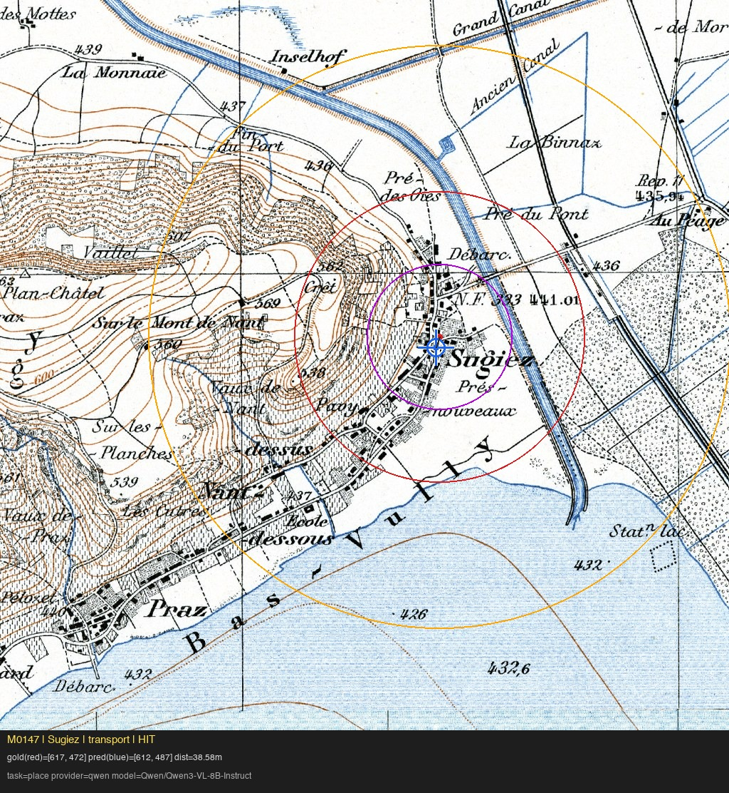
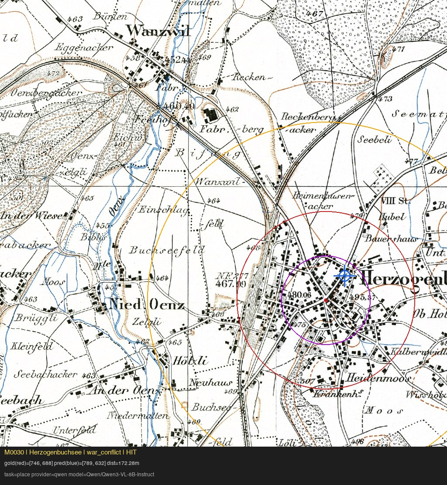
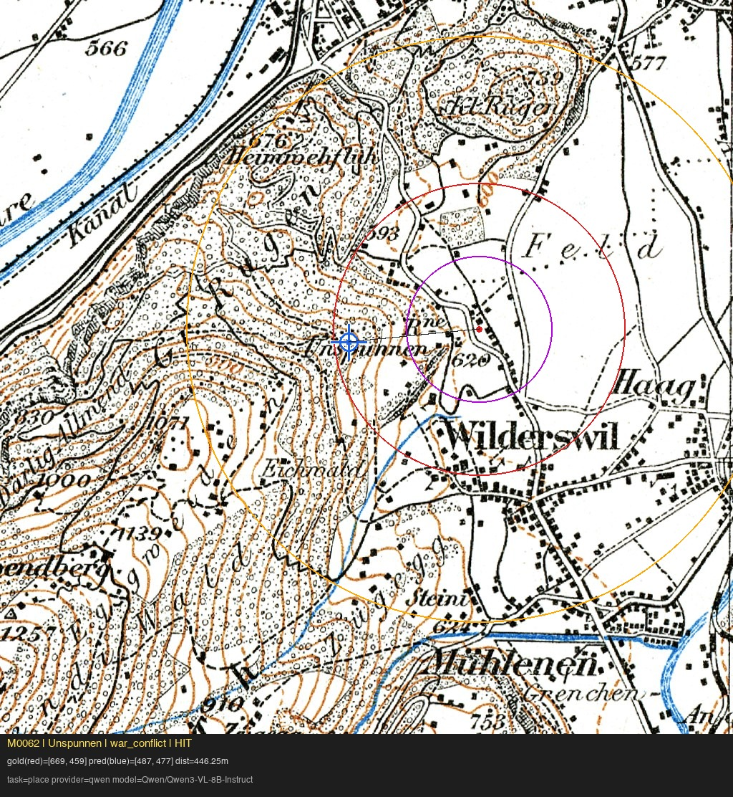
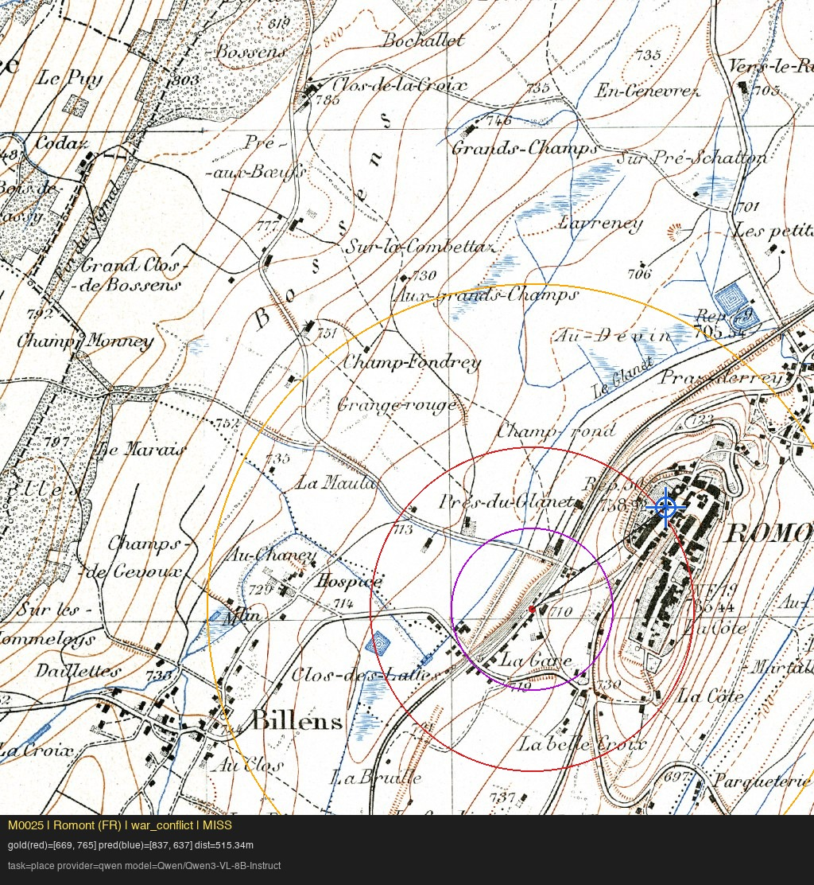
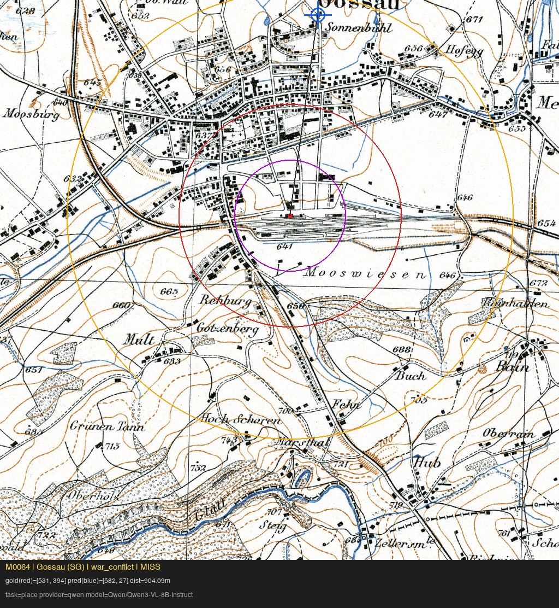

# Place Grounding Showcase — Qwen3-VL-8B on 2.5 km Siegfried Crops

**Model**: Qwen3-VL-8B-Instruct (local, Apple Silicon MPS)  
**Benchmark**: 2.5 km × 2.5 km crops, ±25% random offset, 1024×1024 px (~2.44 m/px)  
**Task**: Given a historical place name, predict its pixel coordinate on the Siegfried map  
**Circles**: purple = 250 m, red = 500 m, orange = 1000 m · Blue crosshair = model prediction

---

## Successful Localisation

### Sugiez — dist 38.6 m (transport)

Near-perfect prediction. The model correctly identifies the small lakeside village at the southern tip of Lake Murten.

---

### Herzogenbuchsee — dist 172.3 m (war/conflict)

Strong hit well within the 250 m circle. The town's road junction and railway crossing are clearly legible on the Siegfried map.

---

### Unspunnen — dist 446.2 m (war/conflict)

Notable recovery case: on 6 km crops this item consistently produced a placeholder output (`{"x": 123, "y": 456}`). At 2.5 km resolution the model locates the castle ruin correctly within 500 m.

---

## Failure Cases

### Romont (FR) — dist 515.3 m (war/conflict)

Just outside the 500 m circle. The model places the prediction in the right general area but misjudges the exact settlement position.

---

### Gossau (SG) — dist 904.1 m (war/conflict)

Clear failure. The prediction lands near the top of the image, far from the actual settlement. Gossau's urban fabric may be ambiguous to distinguish from neighbouring St. Gallen on the historical map.

---

## Summary (n=20, seed=42)

| Metric | Qwen3-VL-8B (2.5 km) |
|--------|----------------------|
| hit@250m | 25.0% |
| hit@500m | 65.0% |
| hit@1000m | 100.0% |
| median error | 475 m |

→ Full results: [`benchmark/results/RESULTS.md`](../benchmark/results/RESULTS.md)
